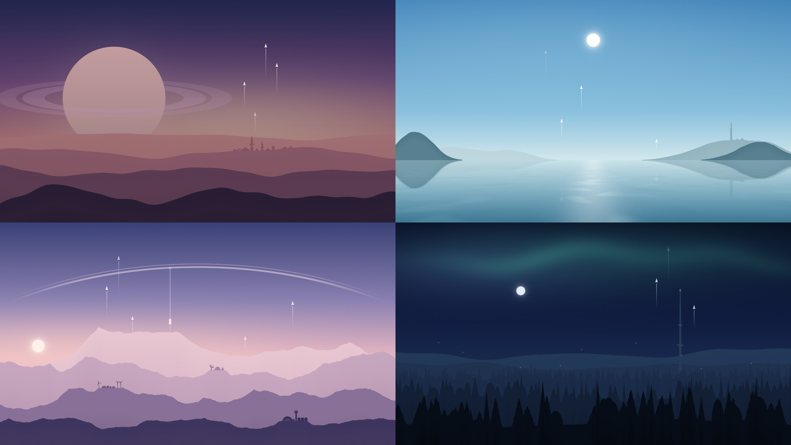

# Sunwalls

Four calm sci-fi wallpapers that change with the sun, for macOS (dynamic `.heic`) and Android (live wallpaper).



> **Homage.** Sunwalls is a love letter to
> [**Exodus** by dpcdpc11](https://www.reddit.com/r/wallpaper/comments/ztxgsq/exodus_by_dpcdpc11_5120x2880/).
> That's the minimal dynamic wallpaper of tiny ships leaving a hazy, layered landscape through the day.
> Everything here borrows its mood: soft gradients, flat silhouettes, quiet departures. None of its artwork
> is included; these scenes are generated from scratch in code.

| Theme | Scene |
|---|---|
| **Ringfall** | Desert dunes under a ringed giant, a domed city on the crest, ships launching |
| **Tidewater** | A still sea between islands, a lighthouse and harbour, craft lifting off the water |
| **Meridian** | Snowy ranges under an orbital ring and a space-elevator cable, a different settlement on every ridge |
| **Canopy** | A forest valley with a tall spire, cabins among the trees, aurora at night |

Each theme has 16 moments from midnight to 22:00. The sun, moon and stars move, ships climb, and lights come
on at dusk. See [`previews/`](previews) for the full sequences.

## Download

Grab the files from the [**latest release**](../../releases/latest):

- `Ringfall.heic`, `Tidewater.heic`, `Meridian.heic`, `Canopy.heic`: macOS dynamic wallpapers, 5120×2880, 16 frames each
- `Sunwalls.apk`: Android live wallpaper (Android 8+)

### macOS

1. **System Settings → Wallpaper → Add Photo…**, pick a `.heic`.
2. Choose **Dynamic**.
3. Keep **Location Services** on for System Settings, so macOS knows where the sun is.

The frames carry Apple's `apple_desktop:solar` metadata: each one is tagged with the sun's altitude and
azimuth, and macOS shows the frame nearest the real sun where you are. So summer days stay bright longer and
winter days are short and dim.

### Android

1. Copy `Sunwalls.apk` to your phone and open it. Allow installs from that source when asked, since it isn't
   on the Play Store.
2. Open **Sunwalls**, pick a theme, tap **Set as wallpaper** (tap the image to hide or show the controls).
3. Optional: switch **Use my location** on, or leave it off and type your latitude and longitude. The default is Berlin.

Frames switch with a slow fade, the wallpaper checks once a minute while visible, and it is always framed the same
way as the in-app preview.

## Build it yourself

| Folder | Contents |
|---|---|
| [`generator/`](generator) | Python renderer for all scenes, sun-tag metadata, and a Swift HEIC packer (Apple ImageIO) |
| [`android/`](android) | Live-wallpaper app: plain Java, built with the SDK command-line tools (no Gradle) |

```bash
cd generator
python3 -m venv .venv && .venv/bin/pip install numpy pillow scipy
.venv/bin/python build.py preview           # quick look at every theme
.venv/bin/python build.py mac               # → out/mac/*.heic (macOS)
.venv/bin/python build.py android           # → out/android/Sunwalls.apk (needs Android SDK)
```

See [`generator/README.md`](generator/README.md) for options and for where to tweak colours, ships, buildings,
haze and frame times.

## Credits

- Inspired by **Exodus** by dpcdpc11. [Original post](https://www.reddit.com/r/wallpaper/comments/ztxgsq/exodus_by_dpcdpc11_5120x2880/).
- The dynamic-wallpaper metadata format was documented by the community. See
  [NSHipster](https://nshipster.com/macos-dynamic-desktop/) and
  [wallpapper](https://github.com/mczachurski/wallpapper).
